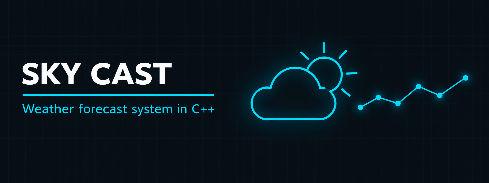

<p align="center">
  
</p>

<h1 align="center">Sky Cast</h1>

<h3 align="center">Console weather forecast system in C++ for Pakistani cities</h3>

<p align="center">
  
  
  
  
</p>

<p align="center">
  <a href="#overview"><b>Overview</b></a> ·
  <a href="#features"><b>Features</b></a> ·
  <a href="#tech-stack"><b>Tech Stack</b></a> ·
  <a href="#interface-preview"><b>Interface</b></a> ·
  <a href="#build--run"><b>Build</b></a> ·
  <a href="#repository-structure"><b>Structure</b></a>
</p>

---

## Overview

Sky Cast is a console weather application written in C++. It fetches live data from the OpenWeatherMap API for Pakistani cities and lets the user check current weather, view a 5-day forecast, search cities by weather condition or temperature, and read weather history, safety alerts and educational content. It applies object-oriented programming, external API integration, JSON parsing and file handling in one program.

| | |
| --- | --- |
| **Language** | C++ |
| **Interface** | Console menu with 8 options |
| **Data source** | OpenWeatherMap API |
| **Libraries** | libcurl (HTTP requests), RapidJSON (JSON parsing) |
| **Storage** | Weather history saved to files (`fstream`) |
| **Coverage** | Major Pakistani cities |

## Features

| Menu | Feature | Description |
| ---- | ------- | ----------- |
| 1 | Weather by city | Current temperature, humidity and conditions for a city |
| 2 | Search by condition | Find cities with a given condition such as rain or clouds |
| 3 | Search by temperature | Find cities near a given temperature (within 1°C) |
| 4 | 5-day forecast | Forecast for the next five days |
| 5 | Weather history | View past records stored in files |
| 6 | Alerts and precautions | Weather alerts and emergency preparation guidelines |
| 7 | Learn about weather | Weather types, terminology and facts |
| 8 | Exit | Close the program |

## Tech Stack

| Component | Technology |
| --------- | ---------- |
| Programming | C++ |
| API | OpenWeatherMap |
| HTTP requests | libcurl |
| JSON parsing | RapidJSON |
| File handling | C++ `fstream` |

## Interface Preview

```
============================================================
                 S K Y   C A S T
------------------------------------------------------------
        - Real-time Weather and Temperature Updates
============================================================
            [1] Check Weather by City Name
            [2] Search by Weather Condition
            [3] Search by Temperature
            [4] 5-Day Weather Forecast
            [5] Weather History
            [6] Alerts & Precautions
            [7] Learn About Weather Types
            [8] Exit
```

## Build & Run

A free [OpenWeatherMap API key](https://openweathermap.org/api) is required.

Install the dependencies on Debian, Ubuntu or Kali:

```bash
sudo apt update
sudo apt install g++ libcurl4-openssl-dev pkg-config rapidjson-dev git
```

Clone this repository and RapidJSON, then compile and run:

```bash
git clone https://github.com/abdul-wahid022/cpp-weather-forecast-system.git
cd cpp-weather-forecast-system/"Sky Cast"
git clone https://github.com/Tencent/rapidjson.git
g++ Q1.cpp -o SkyCast -I./rapidjson/include $(pkg-config --cflags --libs libcurl)
./SkyCast
```

## Repository Structure

```
cpp-weather-forecast-system/
├── README.md
├── Sky Cast/                 # source code
│   └── Q1.cpp
└── images/                   # banner
```

## License

Shared for educational reference.

## Contact

<p align="center">
  <b>Abdul Wahid</b>
</p>

<p align="center">
  <a href="mailto:a.wahid7860668@gmail.com"></a>
  <a href="https://www.linkedin.com/in/abdul-wahid022"></a>
  <a href="https://github.com/abdul-wahid022"></a>
</p>
